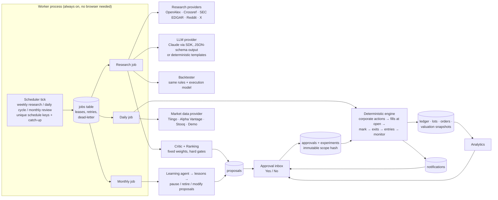

# Architecture

**Chosen stack (equivalent to the PRD baseline, documented deviation):** one Python 3.12 codebase (FastAPI API +
background worker + scheduler) on PostgreSQL 16, and a React 18 + TypeScript + Tailwind + Recharts SPA built with
Vite and served by the API. The PRD suggests Next.js for the frontend. I used a Vite SPA served by FastAPI instead,
because it gives one deployable image and one auth origin (an HttpOnly cookie with no cross-site complexity). The
durable queue is a PostgreSQL table (`FOR UPDATE SKIP LOCKED` plus leases) instead of Redis/Celery, which means one
fewer always-on service to pay for and operate.

## Guarantees and where they live

| Guarantee | Mechanism |
|---|---|
| Model output never touches money | LLM output → JSON Schema → `compile_candidate` → `StrategySpec` (closed enums, ranges, no code) → backtest → proposal. Only `services/engine.py` writes orders/ledger, and it has no LLM import. |
| No look-ahead | `BarView` rejects bars after the decision session and events with `known_at` after decision time; `lag >= 0` enforced by schema; prefix-invariance test. |
| Never backdate a fill | Signals only on closes after `approved_at` (`first_session_with_close_after`); fills only at the *next* session's recorded open; catch-up runs never generate signals. |
| No double fills / overspend | Per-user `pg_advisory_xact_lock`, unique idempotency keys on orders, fills (`fill:{order}`), signals, ledger; cash reservations for pending buys; resize-at-fill never below zero. Concurrency test with 4 threads. |
| Risk limits server-side | `risk.check_entry` inside the engine transaction (also used by the backtester). |
| Tenant isolation | Every API resource fetched via `owned()` (user_id check → 404). Test with a second account. |
| Honest data | Missing data → no fill; delisted/halted → `unresolved` valuation at last recorded close; undefined metrics → `null`; synthetic data always labeled. |
| Auditability | `audit_events` for approvals, pauses, policy versions, engine runs, job failures; immutable strategy versions with rule hash; backtest manifest (dataset fingerprint, code version, rule hash). |

## Module map (`backend/lab/`)

| Module | Role |
|---|---|
| `market_calendar.py` | NYSE sessions, holidays, early closes, DST-correct open/close UTC times |
| `strategy_schema.py` | Versioned declarative schema v1, indicator catalogue + warmups, validation, rule hash |
| `indicators.py`, `rules.py` | Point-in-time indicator math and the rule interpreter (shared by backtest and live) |
| `execution.py`, `risk.py` | Fill model (next open ± slippage), sizing, reservations; risk engine |
| `backtest.py` | Deterministic backtester, 60/20/20 partitions, stress costs, sensitivity, manifest |
| `services/engine.py` | Daily paper-trading cycle and monitoring agent |
| `services/proposals.py` | Proposal creation, idempotent transactional decision, revalidation, expiry |
| `services/market_data.py` | Ingestion, adjustment-basis guard, point-in-time dataset assembly, data health |
| `agents/research.py` | Weekly research pipeline (retrieve → evidence → rules → validate → rank → publish) |
| `agents/evaluate.py` | Critic (checklist + independent LLM pass) and ranking with hard gates |
| `agents/learning.py` | Monthly learning, versioned modifications, Q&A |
| `providers/` | Market, research, LLM adapters; SSRF-safe HTTP with retries |
| `jobs.py`, `worker.py` | Durable queue, scheduler, worker loop |
| `api/` | FastAPI app, auth/CSRF/rate limits, SPA hosting |

## Agent roles and prompt contracts

Prompt versions are stored with each run (`research_runs.prompt_version`, `llm_calls.prompt_version`).

* **Research agent:** `EVIDENCE_SCHEMA`. It must return a verbatim excerpt. Claims are marked `claim_supported`
  only if the excerpt matches the retrieved text. It runs disconfirming queries every time.
* **Strategy agent:** `CANDIDATE_SCHEMA` (building blocks). Citations must be retrieved, supported evidence IDs.
  Its output is compiled into the strict schema, and anything invalid is rejected.
* **Critic agent:** a separate call with its own `CRITIC_SCHEMA`. It cites claims by ID. It is labeled as a model
  pass, not human review.
* **Ranking service:** deterministic, with fixed weights (25/20/20/15/10/10) and hard gates. No model is involved.
* **Monitoring agent:** deterministic daily thesis status and pre-approved invalidation rules. It cannot place orders.
* **Learning agent:** the deterministic verdict uses minimum sample sizes. The LLM may narrate but cannot change the
  verdict. Recommendations become proposals that need approval.

All fetched text is wrapped in `<untrusted_documents>`. The system preamble forbids following embedded instructions,
and the model has no tools. Each call is validated, retried at most 3 times, then quarantined, and every run has a
budget cap.
